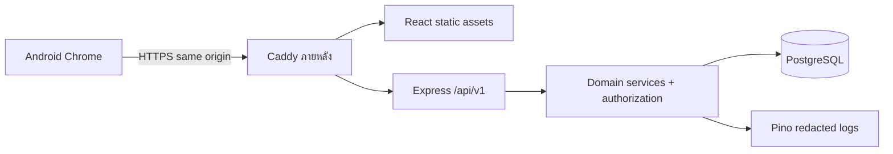

# สถาปัตยกรรม

## ขอบเขตและโครงสร้างเป้าหมาย

```text
apps/web/src/       React, Thai UI, domain screens, typed API client
apps/api/src/       Express composition root, middleware, domain modules
packages/shared/   money strings, error codes, DTO types
packages/validation/ Zod schemas and OpenAPI generation
docs/              decisions, requirements, contracts, acceptance evidence
infra/             Compose, backup/restore instructions (สร้างใน Phase 1)
```

ยังไม่สร้าง package เปล่าในรอบเอกสาร validation มีหน้าที่ runtime parsing;
shared ไม่มี DB objects หรือ secrets หลีกเลี่ยง import server ไป frontend
module: auth, access, catalog, accounts, business-days, sales, reconciliation,
expenses, owner-transactions, transfers, refunds, reporting, audit
HTTP route/controller parse/authorize → service กำหนด transaction → repositories รับ tx เดียวกัน
ไม่ให้ repository commit เอง ไม่มี generic repository/interface ที่ไม่มีความจำเป็น



ใช้ session store ใน PostgreSQL ไม่เพิ่ม Redis; server หนึ่งหรือหลาย process ใช้ locks ใน DB ร่วมกัน
money ledger เป็น append-only projection จาก source ที่มี FK ไม่ใช่ระบบบัญชีแยกประเภทเต็มรูปแบบ
ไม่ใช้ event sourcing หรือ message broker

## Security contract

password ใช้ Argon2id โดย calibrate บนเครื่อง deploy; ไม่ใช้ password seed คงที่
session token random 256-bit ส่ง cookie เท่านั้น เก็บ SHA-256 digest ใน DB;
rotate หลัง login, revoke logout/password change/disable user; idle 12 ชั่วโมง absolute 7 วันเป็น technical default
cookie HttpOnly, SameSite=Lax, Path=/, Secure production; ใช้ชื่อ __Host-session ใน production
dev ใช้ cookie ชื่อแยกเมื่อ localhost HTTP
CSRF synchronizer token ผูก session; GET /auth/csrf ก่อน login ใช้ anonymous session อายุสั้น
mutation ต้อง X-CSRF-Token และ exact Origin allowlist; production same origin ไม่เปิด wildcard CORS
login generic error, limit ต่อ IP และ normalized username; counter อยู่ PostgreSQL เพื่อข้าม process
ไม่ lock account ถาวรเพราะ attacker; audit failed login โดยไม่ log password/token
authorization ตรวจ active membership จาก DB ทุก request; owner role อยู่ business_memberships
MANAGER/STAFF อยู่ store_memberships ไม่มีสิทธิ์ whole business โดยอัตโนมัติ
resource lookup ใช้ composite business/store/id; inaccessible resource ตอบ 404 โดยไม่เผยว่ามีอยู่
403 ใช้เมื่อเข้าถึงร้านได้แต่ action ไม่พอ; response ห้ามส่ง bank details ทั้งกิจการให้ STAFF
trust proxy default false; production configure trusted proxy IPs/hops ตามเส้นทางจริง
Zod strict object + body size limit, SQL parameterized, response DTO allowlist, security headers
logger redact cookie, authorization, password, session, CSRF; เก็บ requestId และ business action ID
audit เก็บ field ที่จำเป็น ไม่ใส่ credential; runtime DB role ไม่เป็น schema owner
DB role ห้าม UPDATE/DELETE ledger/audit/confirmed source; source lifecycle derive จาก reversals
การเปลี่ยน day state/expense state ใช้ service ที่อนุญาตเท่านั้น; restrict SQL credentials จาก client

## ความถูกต้องและงานดูแล

ทุก write ของเงินใช้ tx ตาม domain-rules.md; แสดงสำเร็จเฉพาะหลัง COMMIT
read report รวม SQL statement เดียวหรือ REPEATABLE READ read-only เพื่อ snapshot สอดคล้อง
store cash balance เทียบ ledger, payment/source sums, transfer pairs ด้วย diagnostic queries
seed development: สองร้าน ผู้ใช้จาก env เมนู/บัญชีทดสอบ ติดป้าย development ชัดเจน
ไม่ seed ยอดขายใน production ไม่รัน seed โดยอัตโนมัติเมื่อ start
.env.example ระบุ DATABASE_URL, SESSION_SECRET/CSRF settings, APP_ORIGIN, PORT,
TRUST_PROXY, SEED_OWNER_PASSWORD โดยไม่มี secret จริง; validate config แล้ว fail fast

foundation scripts: dev, build, typecheck, lint, test, test:integration, db:migrate, db:seed
npm ci ใช้ lockfile; migrations แยกงาน deploy ไม่ auto schema push ใน production
CI เริ่ม PostgreSQL จริง รัน migrations จากศูนย์และอัปเกรด fixture, typecheck/lint/unit/integration/build
production ต้องผ่าน restore rehearsal และ Android workflow ก่อนเรียกพร้อมใช้
backup: pg_dump encrypted นอก host รายวัน + retention 30 วัน; ก่อน migration backup เพิ่ม
เป้าหมายเสนอ RPO 24h/RTO 4h รอยืนยันก่อน deploy; restore DB แยก ตรวจ row counts,
ledger invariants และ login/sale read จากข้อมูลสำรอง ห้าม overwrite production ในการซ้อม
หลัง restore revoke sessions; บันทึกเวลาจริงและผลตรวจ ไม่ถือว่ามี backup เพราะ command exit 0 อย่างเดียว

## การต่อยอด

Recipe/inventory ใช้ product ID และ business/store scopes เดิม เพิ่ม recipe versions, lots,
stock movements, production batches แยกจาก money movements; ยังไม่สร้างตารางเหล่านี้
เพิ่ม COGS snapshots ในอนาคตโดยไม่แก้ sale price snapshots
offline queue ต้องมี explicit status/identity binding/conflict policy ก่อนเปิดใช้;
MVP ไม่มี service worker cache API/session และไม่มี background sync guarantee
