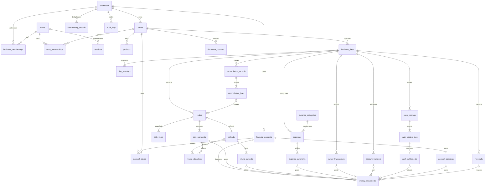

# แบบข้อมูล PostgreSQL

Identity/access 8 ตาราง implement ใน `apps/api/src/db/schema.ts` และ migration `0000_identity_access.sql` แล้ว
ต้นทางธุรกรรมขาย/จ่ายและ closing ด้านล่างยังเป็น specification ดูผล identity constraints ใน [access-validation.md](access-validation.md)
products/idempotency_records เพิ่มแล้วใน migration0001; [ผลตรวจ S1a](catalog-validation.md)
financial_accounts/account_stores/account_openings/money_movements เพิ่มใน0002 ดู [ผลตรวจ S1b](accounts-validation.md)
business_days/day_openings เพิ่มใน0003 ดู [ผลตรวจ S1c](business-days-validation.md)
sales/sale_items/sale_payments/document_counters เพิ่มใน0004 ดู [ผลตรวจ S2](sales-validation.md)
0005 เพิ่ม sales.reason และชนิด SUPPLEMENTAL/counter; ไม่มี item/discount และต้องมี reason
0006 เพิ่ม reconciliation_records/lines และชนิด RECONCILIATION; composite FKs/deferred guards
เก็บ base_revision/day_revision และ linked sale ต่อdeltaบวก; delta0ต้องไม่มีsale, runtime INSERT-only
deferred posting guard แยก POS item sum กับ SUPPLEMENTAL item count=0; payments/ledger ต้องครบทั้งคู่
ledger ตอนนี้รองรับ account_opening หรือ sale_payment เท่านั้น พร้อม day_id ของ payment; เปิดวันไม่มี movement
ชนิดขาย SUPPLEMENTAL/RECONCILIATION, debit sources และ closing ด้านล่างยังเป็น specification
ใช้ UUID PK ทุกตาราง เว้นระบุ; B=business_id UUID NOT NULL; S=store_id UUID NOT NULL;
T=created_at timestamptz NOT NULL DEFAULT now(); U=created_by UUID NOT NULL FK users
เงินทุก field BIGINT หน่วยสตางค์, ID API เป็น UUID string; timestamp UTC/offset, business_date DATE
ทุก field ในตารางด้านล่าง NOT NULL เว้นมี `?`; ไม่ใช้ float
ทุก business-owned table มี UNIQUE(B,id); ทุก store-owned table มี UNIQUE(B,S,id)
FK ข้าม business/store ใช้ composite ตาม candidate key เหล่านี้ ไม่อาศัย UUID อย่างเดียว
store FK `(B,S)→stores(B,id)`; day FK `(B,S,day_id)→business_days(B,S,id)`
RESTRICT/NO ACTION เป็น deletion default ทุก FK; confirmed financial data ไม่ลบ
users/products/accounts/categories/memberships ใช้ active=false; sessions/expired login counters ลบได้
audit actor FK RESTRICT เพื่อรักษาประวัติ ไม่มี cascade จาก business/store ไปธุรกรรม

## Identity และ catalog

| ตาราง / หน้าที่ | คอลัมน์หลัก | Constraints และ indexes เพิ่มเติม |
|---|---|---|
| businesses / กิจการ | id, name text, timezone text, currency text, T,U | timezone='Asia/Bangkok', currency='THB'; bootstrap U ต้องอ้าง user ที่สร้างก่อน |
| users / ผู้ใช้ | id, username text, password_hash text, active boolean, T | unique lower(username); ไม่เก็บ plaintext; ผู้สร้างแรกไม่มี U |
| business_memberships / business identity | id,B,user_id,role,active,T,U | FK user; unique(B,user_id); role IN OWNER/MEMBER; MEMBER ไม่มี business permission เป็นฐาน FK สำหรับ MANAGER/STAFF |
| stores / ร้าน | id,B,name text,code text,active boolean,T,U | unique(B,code); FK B |
| store_memberships / สิทธิ์ร้าน | id,B,S,user_id,role,active,T,U | role IN MANAGER/STAFF; unique(B,S,user_id); index(user_id,active) |
| sessions / session server | id,B?,user_id?,token_hash bytea,csrf_hash bytea,created_at,expires_at,last_seen_at,absolute_expires_at,revoked_at? | unique token_hash; index(expires_at), (user_id); composite FK(B,user_id)→business_memberships; B/user nullable พร้อมกันเฉพาะ anonymous; hashes 32 bytes; expiry≤absolute |
| login_attempts / จำกัด login | id,bucket_key text,window_start timestamptz,attempts int,expires_at | unique(bucket_key,window_start); attempts>0; index expires_at; HMAC bucket ไม่เก็บชื่อ/IP/รหัสผ่านดิบ |
| products / เมนูต่อร้าน | id,B,S,name text,price bigint,version int,active boolean,T,U | price>0, version>0; index(B,S,active,name); current price update เพิ่ม version |
| financial_accounts / บัญชีจริง | id,B,name text,type text,active boolean,T,U | type CASH/BANK; unique(B,name); index(B,active) |
| account_stores / อนุญาตบัญชี | id,B,S,account_id,T,U | composite FK account; unique(B,S,account_id); index(B,account_id) |
| expense_categories / หมวด | id,B,name text,active boolean,T,U | unique(B,name) |

cash account หนึ่งร้านต่อบัญชี enforce ด้วย deferred constraint trigger บน account_stores/accounts
bank แชร์ได้หลายร้านแต่ไม่มี balance ซ้ำ; ห้ามเปลี่ยน type/ถอด store mapping ที่ใช้ในประวัติ
price history เต็มตารางไม่จำเป็นใน MVP: sale_items snapshots + audit price changes เพียงพอ

## วันและต้นทางธุรกรรม

| ตาราง / หน้าที่ | คอลัมน์หลัก | Constraints และ indexes เพิ่มเติม |
|---|---|---|
| business_days / วันทำการ | id,B,S,business_date,state,revision bigint,closing_version int,opened_at,T,U | unique(B,S,business_date); partial unique(B,S) WHERE OPEN; state OPEN/CLOSED; revision/closing_version>=0; date ตรง opened_at Bangkok |
| day_openings / ฐานเงินสด | id,B,S,day_id,account_id,amount bigint,recorded_at,T,U | composite day/account_stores FK; unique(day_id,account_id); amount>=0 |
| document_counters / ลำดับอ้างอิง | id,B,S,business_date,kind,next_number bigint | unique(B,S,business_date,kind); next_number>0; lock row ใน tx |
| sales / ขายทุกแบบ | id,B,S,day_id,kind,reference text,gross,discount,net bigint,day_revision bigint,occurred_at,T,U | 0004 kind POS เท่านั้น; reason/ชนิดอื่นรอ D1; gross>0; net=gross-discount>0; unique(B,S,reference), unique(day_id,day_revision); index(B,S,occurred_at,id) |
| sale_items / snapshot | id,B,S,sale_id,position int,product_id,name_snapshot text,unit_price bigint,product_version int,quantity int,line_total bigint | composite sale/product FK; unique(sale_id,position), unique(sale_id,product_id); quantity1..999; line_total=price*quantity; position0..99 |
| sale_payments / รับเงิน | id,B,S,day_id,sale_id,account_id,channel,amount bigint,tendered bigint?,change bigint? | composite sale/day/account_stores FK; unique(sale_id,account_id), unique(B,S,day_id,account_id,id); amount>0; CASH tendered>=amount/change=tendered-amount; TRANSFER both NULL |
| reconciliation_records / ยืนยันส่วนต่าง | id,B,S,day_id,base_revision bigint,reason text,T,U | unique(B,S,id); index(day_id,T); ไม่แก้ผลเดิม |
| reconciliation_lines / target ต่อบัญชี | id,B,S,reconciliation_id,account_id,channel,recorded bigint,target bigint,delta bigint,resulting_sale_id? | unique(reconciliation_id,channel,account_id); target/recorded signed เพราะเป็นยอดสุทธิ; delta=target-recorded>=0; resulting sale NULL iff delta=0; FK sale/day scope ตรวจ trigger |
| refunds / คืนเต็มบิล | id,B,S,day_id,sale_id,amount bigint,reason text,reference,occurred_at,T,U | unique(sale_id); amount>0; composite sale/day FK; unique(B,S,reference); index(B,S,day_id) |
| refund_allocations / ลด bucket ขายเดิม | id,B,S,refund_id,sale_payment_id,amount bigint | amount>0; unique(refund_id,sale_payment_id); composite FKs; ตรวจ payment belongs sale ด้วย deferred trigger |
| refund_payouts / เงินจ่ายจริง | id,B,S,refund_id,account_id,amount bigint | amount>0; composite FK refund/account_stores; unique(refund_id,account_id); index(account_id) |
| expenses / รับรู้รายจ่าย | id,B,S,day_id,category_id,amount bigint,description text,evidence_reference text?,occurred_at,T,U | amount>0; composite category/day FK; index(B,S,day_id), (B,category_id); paid status derive active payment/reversals |
| expense_payments / จ่ายเต็ม | id,B,S,day_id,expense_id,account_id,amount bigint,occurred_at,T,U | amount>0; composite expense/day/account_stores; index(expense_id); หนึ่ง active payment ผ่าน lock+deferred trigger (reversed payment เก็บไว้) |
| owner_transactions / เติมทุนถอน | id,B,S,day_id,account_id,kind,amount bigint,note text,occurred_at,T,U | kind CONTRIBUTION/WITHDRAWAL; amount>0; composite account/day FKs; index(B,S,day_id) |
| account_transfers / โอน | id,B,source_store_id,destination_store_id,source_day_id,destination_day_id,source_account_id,destination_account_id,amount bigint,fee_expense_id?,reason text,occurred_at,T,U | amount>0; source!=destination account; composite store/day/account_stores ทั้งสองฝั่ง; unique fee_expense_id; index(B,source_day_id), (B,destination_day_id) |
| account_openings / ยอดก่อนเริ่มระบบ | id,B,S,account_id,amount bigint,cutover_at,reason text,T,U | unique(B,account_id); amount>=0; composite account_stores FK; bank shared attribution เป็นร้านที่ OWNER เลือก ไม่ใช่ balance แยกร้าน |
| cash_closings / snapshot การปิด | id,B,S,day_id,version int,day_revision bigint,closed_at,T,U | unique(day_id,version); index(B,S,closed_at) |
| cash_closing_lines / ตรวจนับบัญชี | id,B,S,closing_id,account_id,expected bigint,counted bigint,variance bigint,reason text? | unique(closing_id,account_id); counted>=0; variance=counted-expected; reason required if variance!=0 |
| cash_settlements / อนุมัติส่วนต่าง | id,B,S,day_id,closing_line_id,account_id,amount bigint,reason text,T,U | unique(closing_line_id); signed amount=variance ตรวจ trigger; zero ได้ ไม่สร้าง ledger |
| reversals / ย้อนต้นทาง | id,B,S,day_id,source_sale_id?,source_expense_id?,source_expense_payment_id?,source_owner_id?,source_transfer_id?,source_settlement_id?,reason text,occurred_at,T,U | CHECK num_nonnulls(source_*)=1; partial unique ของแต่ละ source WHERE NOT NULL; composite FK ทุก source; source_transfer FK B/id + service ตรวจสองร้าน |

reversals ของ transfer ใช้ S เป็นร้านต้นทางและ day_id วันปัจจุบันต้นทาง;
ต้องมี destination_day_id? FK วันร้านปลายทางเมื่อ source_transfer_id ไม่ NULL เพื่อ lock/post ทั้งสองร้าน
reversal ของ sale มี allocation ตาม sale_payments เดิมจาก amount เต็ม ไม่เก็บยอด client
ทุกตาราง source ที่เป็น store-owned มี scope keys ตาม convention แม้ไม่ได้เขียนซ้ำในแต่ละแถว

## Ledger, audit, idempotency

money_movements: id,B,S,day_id? (NULL เฉพาะ account opening),account_id,delta bigint,T,U,
sale_payment_id?,refund_payout_id?,expense_payment_id?,owner_transaction_id?,transfer_id?,
account_opening_id?,cash_settlement_id?,reversal_id?,reverses_movement_id?,leg text

- CHECK delta != 0 และ `num_nonnulls` ของ source ทั้งแปดคอลัมน์ = 1 (reverses_movement ไม่ใช่ source)
- ทุก source มี composite FK (B,S,id); transfer ใช้ (B,id) และ deferred trigger ตรวจ leg/store/day/account
- unique source slot: sale_payment_id; refund_payout_id; expense_payment_id; owner_transaction_id;
  account_opening_id; cash_settlement_id แบบ partial unique WHERE NOT NULL
- transfer unique(transfer_id,leg) เฉพาะ source transfer; leg OUT/IN โดย delta -/+amount
- reversal unique(reversal_id,reverses_movement_id); unique(reverses_movement_id) WHERE NOT NULL;
  FK reverses_movement_id ไป ledger เดิมพร้อม B และตรวจ delta=-original.delta/account/store ตรง
- index(B,account_id,T,id) สำหรับยอดจริง, (B,S,day_id,account_id) สำหรับปิดวัน
- amount ของ owner/opening/settlement/payment ต้องตรง source และ leg; movement ห้ามข้าม account mapping
- ไม่ใช้ source_type/source_id ที่ไร้ FK; ต้นทางเพิ่มใหม่ต้อง migration เพิ่ม FK/check/index

audit_logs: id,B,S?,actor_user_id FK users,action text,entity_type text,entity_id UUID,
before_data jsonb?,after_data jsonb?,reason text?,request_id UUID,T
entity_type/id เป็น informational reference ไม่ใช้คำนวณเงินและไม่ได้ FK polymorphic;
index(B,S,T,id), (B,entity_type,entity_id,T); INSERT-only; auth logs แยก application log ที่ redact

idempotency_records: id,B,user_id FK users,key UUID,method text,path text,payload_hash bytea,
response_status int,response_body jsonb,resource_id UUID?,T
UNIQUE(B,user_id,key), index(B,T); status 200..299 สำหรับ committed response;
ทุกคอลัมน์ response NOT NULL ก่อน commit; ไม่มี durable pending state; resource_id เป็น metadata
ไม่เก็บ credential ใน payload/response; hash canonical payload แทนเก็บ payload ดิบ

## Enforcement ที่ต้องทำจริง

DB: PK/FK/scopes, NOT NULL, checks, unique, source slots, immutable permissions,
deferred constraint triggers ตรวจเมื่อ commit: payment sum=net, item sums=gross เฉพาะ POS,
supplemental ไม่มี item/discount, channel/account type, refund allocations/payout totals,
expense active payment หนึ่งชุด, source/ledger complete exactly once, transfer legs/fee/reversal,
opening/day mapping, source date scope. Trigger ต้องตรวจทั้ง child และ parent changes
เพื่อไม่ให้ insert parent เปล่าโดยไม่มี child ผ่านได้ รายการ zero settlement ไม่ต้อง movement

Service ใน transaction: permission, OPEN/day revision, lock ordering, trusted prices,
refund eligibility, no overdraft, full-only reversal, business date/timezone, previous day gate,
cash snapshot consistency, counter scope, idempotency hash/replay และ audit fields
cross-row aggregates ต้องใช้ lock ก่อนตรวจ; deferred trigger เป็นแนวป้องกันเพิ่ม ไม่แทน concurrency locks
migration tests ต้องลอง direct SQL ละเมิดแต่ละ invariant ด้วย ไม่ถือว่า service validation แทน constraints

## ERD หลัก

ERD ย่อไม่แสดง FK actor/tenant ทุกเส้นเพื่อลดความรก ตาราง specification เป็นข้อกำหนดครบ
document reference เช่น ND-20261022-S-000001 scope business/store/date/kind;
ออกเลขใน transaction เดียวกับเอกสาร ไม่รับประกันเลขไม่ขาด และไม่ใช้เป็น PK
