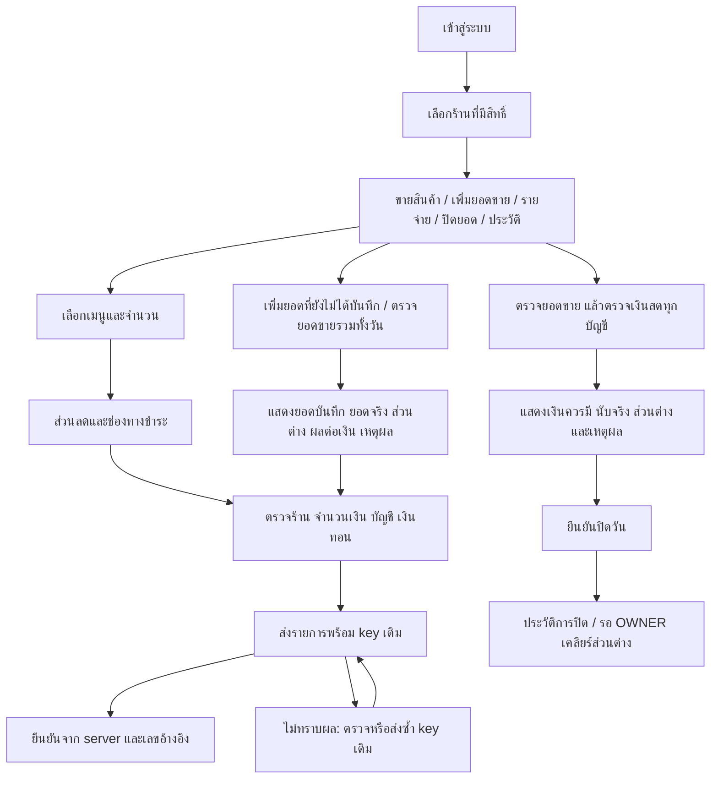

# UX flow สำหรับ Android

เป็น flow specification ของ MVP; S3 หน้าขาย/ชำระ/ตรวจบิล/ประวัติ implement แล้ว
ตรวจ browser ด้วยข้อมูลจำลอง ดู [pos-validation.md](pos-validation.md); ยังไม่ตรวจ Android เครื่องจริง
flow เพิ่มยอด รายจ่าย คืนเงิน ปิดวัน และรายงานส่วนที่เหลือยังเป็นแผน
mobile-first พื้นขาว ตัวอักษรอย่างน้อย 18px สำหรับเนื้อหาหลัก ปุ่มสูงอย่างน้อย 48px
น้ำเงินเข้มเป็น action หลัก ใช้ข้อความและ icon ร่วมสี; เลื่อนแนวตั้ง ไม่ใช้ตารางกว้างในหน้าขาย
ทุกหน้าธุรกรรมมีชื่อร้านและวันทำการคงที่ด้านบน; เปลี่ยนร้านเมื่อมี draft ต้องเลือกเก็บ/ทิ้ง/อยู่ต่อ

## คำสำคัญบนหน้าจอ

“เพิ่มยอดที่ยังไม่ได้บันทึก”: กรอกเฉพาะยอดที่ยังไม่เคยลง ไม่ใช่ยอดทั้งวัน
“ตรวจยอดขายรวมทั้งวัน”: กรอกยอดสุทธิหลังคืนเงิน รวมยอดทุกวิธีที่บันทึกแล้ว
เลือกบัญชีทีละ bucket แสดง recorded/target/delta; บัญชีไม่ทราบต้องเลือกรายการก่อนยืนยัน
target ต่ำกว่า: “ยอดจริงต่ำกว่าที่บันทึก กรุณาตรวจบิลซ้ำหรือคืนเงิน” พร้อมทางไปประวัติ
ไม่แสดงปุ่มที่จะลดยอดให้อัตโนมัติ
close: “ส่วนต่างนี้ยังไม่ปรับยอดเงิน” OWNER เห็น action “ยืนยันปรับส่วนต่าง” พร้อม delta/reason
รายงานใช้ “ยอดขายสุทธิ”, “รายจ่ายที่เกิด”, “เงินจ่ายจริง”, “กระแสเงินสด” ไม่มี “กำไรสุทธิ”

## State ที่ต้องออกแบบและทดสอบ

| State | พฤติกรรม |
|---|---|
| Loading | progress + ป้องกันกดซ้ำ; server idempotency ยังจำเป็น |
| Empty | บอกยังไม่มีเมนู/บัญชีและให้ OWNER ตั้งค่าก่อนขาย; ไม่ใส่ยอดตัวอย่าง |
| Validation | แสดงใต้ช่องพร้อม focus/aria-live; รักษาค่าที่กรอก |
| Server error | ข้อความภาษาไทย + request reference ไม่แสดง stack |
| Offline | banner “ยังไม่ได้เชื่อมต่อ” ปิด submit เก็บ draft ที่ยังไม่ยืนยัน |
| Timeout | “ยังไม่ทราบผลการบันทึก” retry key/payload เดิม; ห้ามสร้าง key ใหม่ |
| Success | server reference + เปิดประวัติบิลได้ หลัง commit เท่านั้น |
| Price changed | ราคาเดิม/ราคาใหม่และยอดใหม่; กลับตรวจชำระ ผู้ใช้ยืนยันใหม่พร้อม key ใหม่ |
| Stale preview | แจ้งมีรายการใหม่ โหลด preview อีกครั้งก่อนยืนยัน |
| Session expired | หยุดส่ง เข้า login; bind draft กับ user/business/store; ห้าม replay ในนามผู้ใช้อื่น |
| Day closed | แสดงสถานะและทางดูประวัติ; OWNER มี reopen พร้อมเหตุผล |

draft POS/ยอดเพิ่มเติม/target ตรวจยอด เก็บใน sessionStorage แบบผูก user/business/store;
DailyWorkspace คง mount เมื่อสลับแท็บ; pending flow หนึ่งป้องกันเริ่มรายการใหม่อีก flow แต่เปิดประวัติและกู้รายการเดิมได้
preview ที่ยังไม่ยืนยันต้องตรวจใหม่หลังแก้ข้อมูล/reload/STALE_PREVIEW; pending confirm เก็บ preview/revision/targets เดิม
pending mutation เก็บ key และ payload ตามความจำเป็นใน sessionStorage ไม่เก็บ password/session token
logout แจ้งว่ามีผลค้างและล้างข้อมูลส่วนตัว; หลัง login เดิมต้องให้ตรวจสถานะด้วย key เดิมก่อนเริ่มใหม่
การปิด tab ขณะ timeout อาจเสีย draft: ไม่รับประกัน recovery offline ต้องตรวจประวัติ server ก่อนบันทึกใหม่
ไม่ cache private API ด้วย service worker; PWA install shell เป็นงานภายหลัง

Android acceptance: จอกว้าง 360px ไม่มี horizontal overflow, keyboard ไม่บังยอดยืนยัน,
แตะเมนู/เพิ่มจำนวน/แบ่งชำระ/กลับจาก sleep/network toggle/timeout/session expired/เปลี่ยนร้าน
ทดสอบกับแม่ด้วยยอดทดลองใน environment แยก แล้วบันทึกจำนวนขั้นและจุดสับสน
